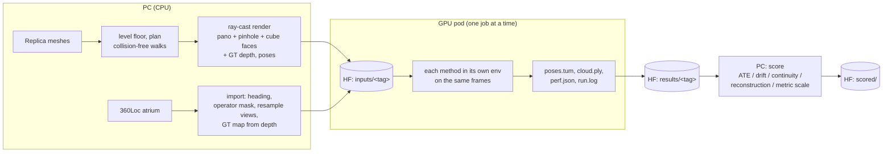
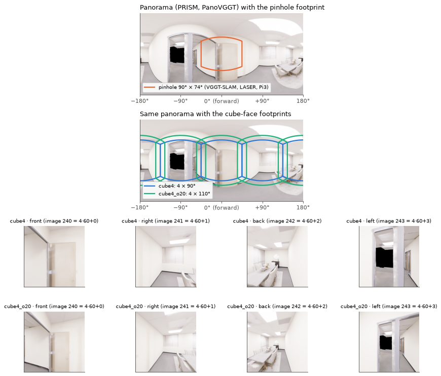
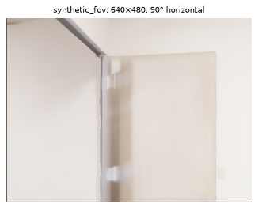
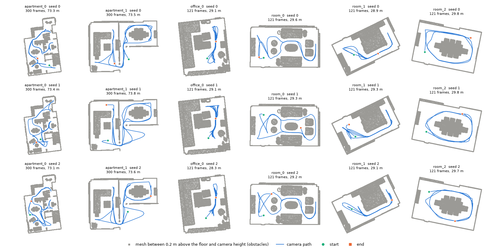
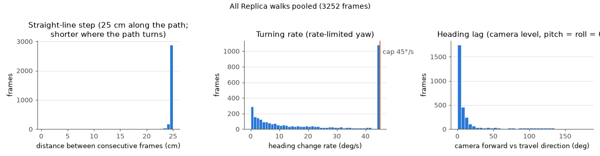
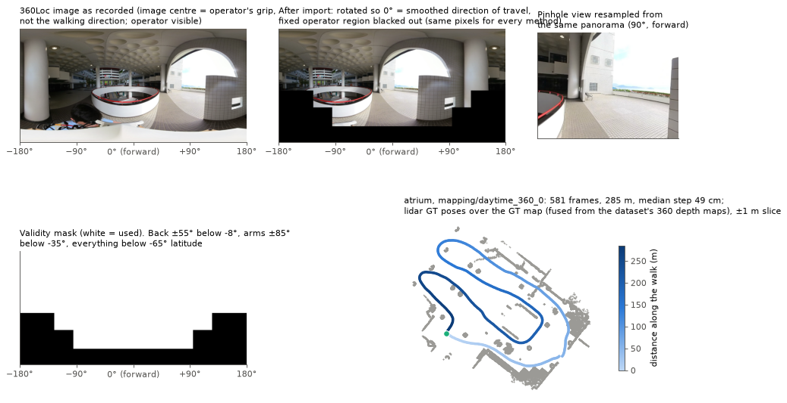
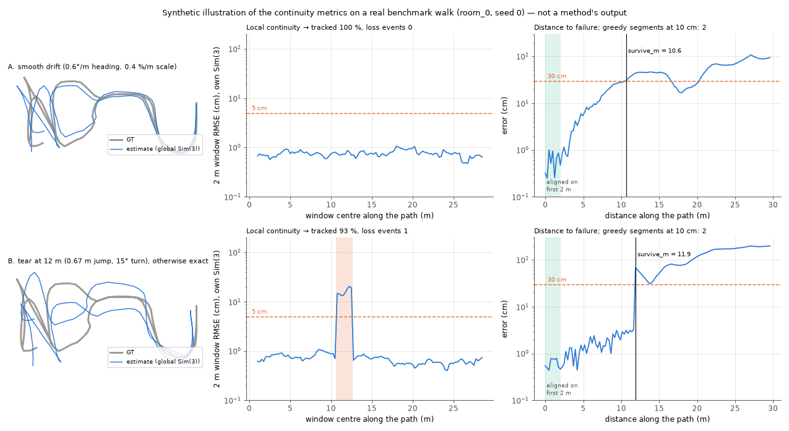
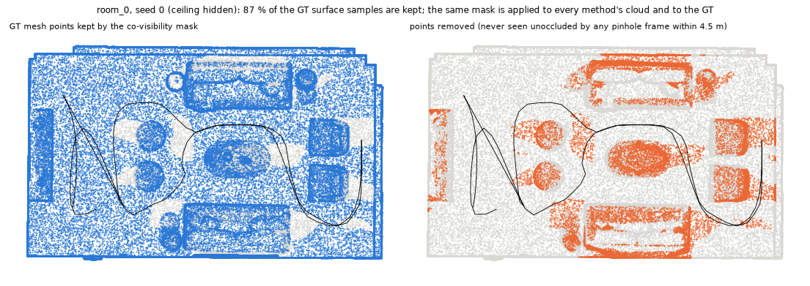

# PRISM-benchmarks

This repository is the harness used to compare **PRISM-VGGT** (a streaming 3D mapping
engine for 360° cameras) with streaming and offline baselines. It contains the data
generation, the run protocol and the scoring code.

It does **not** contain results. The numbers are in the paper. The raw outputs of every
run, the scores computed from them, and the inputs they were computed on are on the
Hugging Face dataset linked below, so every number can be traced to its frames, poses
and logs. This page describes what we did and why, in enough detail to repeat it or to
check it.

| | |
|---|---|
| Code | https://github.com/zRafaF/PRISM-benchmarks (`main`) |
| PRISM-VGGT | https://github.com/zRafaF/PRISM-VGGT, pinned in `bench.env` |
| Inputs, raw results, scores | https://huggingface.co/datasets/DoninhaD/prism-bench-inputs (gated by the Replica terms) |
| Every decision, with the reason and the date | [`documentation/docs/decisions.md`](documentation/docs/decisions.md) (D1–D34) |
| Why older result sets are void | [`RESULTS_CHANGELOG.md`](RESULTS_CHANGELOG.md) |

Contents:

1. [Overview](#1-overview)
2. [Methods and their settings](#2-methods-and-their-settings)
3. [Synthetic data: Replica](#3-synthetic-data-replica)
4. [Camera paths](#4-camera-paths)
5. [Real data: 360Loc](#5-real-data-360loc)
6. [Run protocol](#6-run-protocol)
7. [Scoring](#7-scoring)
8. [Controls and sanity checks](#8-controls-and-sanity-checks)
9. [Assumptions and known limitations](#9-assumptions-and-known-limitations)
10. [Reproducing everything](#10-reproducing-everything)
11. [Audit trail](#11-audit-trail)
12. [Repository layout](#12-repository-layout)

The figures on this page show inputs and metric definitions only; none of them shows a
method's output. They are produced by `scripts/readme_figures.py` (`make readme-figures`)
from the exported inputs.

---

## 1. Overview



Rendering and scoring are CPU work and run on a PC. Only the methods run on a rented GPU.
Data moves between the two only through the HF dataset, under a campaign tag
(`rerun-v3` for Replica, `real360-v1` for 360Loc, `offline-v3` for the offline methods),
so a pod never mixes two campaigns.

## 2. Methods and their settings

Each method is a git submodule at a pinned commit (`bench.env`), installed in its own
virtual environment (`envs/setup_*.sh`), and called through a thin runner
(`adapters/runners/*_runner.py`). A runner converts our input layout into what the
method expects and converts its output back into `poses.tum` (camera-to-world, one pose
per input timestep) and `cloud.ply`. It does not change the method.

| Arm | Method | Input | Mode | Settings as run | Where the settings come from |
|---|---|---|---|---|---|
| `prism` | PRISM-VGGT | panorama | streaming | window 16, overlap 4, Sim(3) window alignment with free scale, 2 cm TSDF voxels, 4.5 m max depth | our defaults; a window study is in decisions D22 |
| `prism_sl4`, `prism_se3` | PRISM-VGGT | panorama | streaming | as `prism`, alignment SL(4) or SE(3) | ablation of the alignment group (D15, D17) |
| `vggtslam` | VGGT-SLAM 2.0 @ `35327ac` | pinhole | streaming | submaps of 32, loop closure on, retrieval threshold 0.95, confidence filter 25 %, **every frame kept** (`min_disparity 0`) | the authors' published configuration, except keyframing (below) |
| `vggtslam_noloop` | VGGT-SLAM | pinhole | streaming | as above, loop closure off | ablation |
| `laser` | LASER @ `7adbb7d` | pinhole | streaming | window 16, overlap 4 | our shared window; LASER's own evaluation uses 20/5, compared in the pilot (D22) |
| `vggtslam_cube`, `laser_cube` | as above | 4 cube faces per timestep | streaming | VGGT-SLAM submap 64 images; LASER window 32 / overlap 8 images | image budgets chosen to fit 32 GB, not tuned (D28) |
| `panovggt` | PanoVGGT (PRISM's backbone) | panorama | offline, all frames in one pass | no streaming, no TSDF, no metric grounding | reference: the backbone without the engine (D34) |
| `pi3` | Pi3 @ `9fa3ddb` | pinhole | offline, all frames in one pass | repository defaults | pinhole feed-forward reference; LASER is built on it (D34) |

Notes on settings that differ from a repository's defaults:

- **VGGT-SLAM keyframing.** Its default `min_disparity` of 50 px drops frames whose mean
  optical flow is small. That threshold suits 30 fps video. Our frames are already 25 cm
  apart, so we keep every frame. The pilot ran both settings (D22). A run with too few
  keyframes builds a single submap and never uses its pose graph, which is why the
  runner records submap and loop-closure counts in `arm_config.json`.
- **PRISM on 360Loc** uses 4 cm voxels instead of 2 cm. At 2 cm the GPU hash table of
  the TSDF ran out of memory on the 61 × 52 m atrium (`config.real360.yaml`, set via
  `PRISM_VOXEL_SIZE`).
- **Offline methods** are first run on every frame of a sequence. If the full sequence
  does not fit in GPU or host memory, that failure is recorded (`logs/offline_oom/`,
  `full_length_oom` in `arm_config.json`) and the sequence is rerun uniformly
  subsampled to 200 frames. Both facts are reported.

PRISM needs one extra input: the camera height above the floor, which it uses to fix
metric scale. It comes from the dataset (Replica: rays cast straight down from the
first pose to the floor of the levelled mesh; 360Loc: the median straight-down depth of the dataset's 360 depth maps). The other
methods receive no extra input. See [§9](#9-assumptions-and-known-limitations).

## 3. Synthetic data: Replica

**Scenes.** Six Replica scenes: `room_0`, `room_1`, `room_2`, `office_0` (single rooms)
and `apartment_0`, `apartment_1` (multi-room). `room_*` and `office_0` are the scenes
used by NICE-SLAM and iMAP, so results can be related to that literature. The
apartments are the multi-room case, with long walks and doorways. The list is frozen in
`config.local.yaml` (`make split`) and is part of the input fingerprint.

**Mesh preparation** (`dataset/render_scene.py::prepare_mesh`):

- **Up axis.** The mesh is rotated so +Z is up.
- **Levelling.** The floor plane is fitted (RANSAC over the lowest standable surface per
  column) and rotated horizontal when it is tilted more than 0.2°. Only `room_2` needs
  this: it is tilted 8.7° in the release (D20).
- **Faces.** Replica's quad faces are triangulated with `plyfile`. Open3D's own PLY
  reader silently dropped about half of `office_0`'s faces.

**Rendering.** Open3D ray casting: one ray per pixel, depth from the hit distance, colour
interpolated from the mesh vertex colours. There is no lighting model, no noise, no
motion blur, no exposure change and no rolling shutter. The renders are therefore
cleaner than any real capture. Ground truth comes for free: the render poses, the mesh,
and the depth buffer.

**Cameras.** Every camera is rendered from the same poses:

| Variant | Used by | Image | Field of view |
|---|---|---|---|
| `pano` | PRISM, PanoVGGT | equirectangular 1036 × 518 | 360° × 180° |
| `synthetic_fov` | VGGT-SLAM, LASER, Pi3 | 640 × 480, f = 320 px | 90° × 74°, looking forward |
| `cube4` | `*_cube` arms | 4 × 512 × 512 per timestep | 90° faces: front, right, back, left |
| `cube4_o20` | `*_cube` arms | 4 × 512 × 512 per timestep | 110° faces (neighbours share 20°) |





The figure is one timestep of `apartment_1`. The pinhole camera looks at a door a metre
away; the panorama also sees the rest of the room. Cube faces are written interleaved:
image `4t + k` is face `k` of timestep `t`, so a pinhole method reading the folder in
order sees the four faces of a timestep back to back. `faces.json` stores the face
rotations, and the runners collapse the four per-face poses back to one pose per
timestep (the front face). `perf.json` counts timesteps, not images.

## 4. Camera paths



**Planner** (`dataset/trajectories.py::grid_walk`, D19):

1. **Free space.** A 5 cm raster of walkable cells: floor below, at least 0.30 m from the
   camera centre to any surface, and at least 0.20 m horizontal clearance for a body
   between the floor and 1 m.
2. **Waypoints.** Up to 12 per lap, drawn from cells at least 0.4 m clear and spread
   out by farthest-point sampling from the clearest cell. They are ordered with 2-opt,
   and each lap draws a fresh set.
3. **Legs.** Dijkstra between waypoints on an 8-connected graph whose edge cost grows
   when clearance drops below 0.60 m, so paths keep to the middle of corridors and
   doorways.
4. **Smoothing.** Line-of-sight shortcutting and Chaikin corner cutting, each applied
   only where the result stays at least as clear as the original.
5. **Check.** An exact mesh check of every camera centre and every frame-to-frame
   segment. Any crossing rejects the walk, and `check_scenes` gates rendering on it.

The rerun-v2 planner checked only its waypoints, and its spline cut through walls in
the apartments. All methods failed at those frames. `scripts/traj_audit.py` re-checks
any rendered or planned walk by ray casting.

**Motion.** Constant 0.5 m/s, sampled every 25 cm of path, which is 2 Hz: the rate at
which the 360° camera on our robot (Ricoh Theta X) delivers frames. The camera is
level (no pitch, no roll). Its heading follows the direction of travel, looking 0.5 m
ahead, but never turns faster than 45°/s.



The 45°/s cap is active on about a third of the frames. Where the path reverses at a
waypoint, the camera keeps turning for a few frames while already moving the other way,
so on about 8 % of frames it looks more than 90° away from the direction of travel. We
kept this behaviour on purpose: it is how a rate-limited robot turns. It is also a
condition in which a forward-facing camera sees mostly sideways or backward motion. The
straight-line step is shorter than 25 cm where the path turns, because frames are
spaced along the path, not along the chord.

**Length and seeds.** A walk's length follows the scene size (D23). Scenes with less than
20 m² of walkable floor (all four rooms) get 30 m, which is 121 frames. The apartments
get 74.75 m, which is 300 frames. Each scene has three walks, from seeds 1234, 5678
and 9012 (`_s0`, `_s1`, `_s2`), each with its own waypoints. The long walks revisit
earlier places, so loop closure has something to close in every sequence. A separate
`loop` family that ended at its start turned out to duplicate the main walks and was
dropped (D21).

**Which arms run which seeds:**

- **All three seeds:** `prism`, `vggtslam`, `laser`.
- **Seed 0 only:** the ablations, the cube-face arms and the offline methods. These are
  comparisons on the same sequences, not variance estimates.

## 5. Real data: 360Loc



To check the harness on a real capture, we import one sequence of
[360Loc](https://github.com/HuajianUP/360Loc) (Huang et al., CVPR 2024): the `atrium`
scene, mapping sequence `daytime_360_0`, all 581 frames. It was captured with a handheld
360° camera, and its poses come from lidar.

- **Why this scene:** it is indoors, mostly static, has metric ground truth and is small
  enough to run in minutes.
- **Scenes we did not use:** `hall` is outdoors. `concourse` and `piatrium` were left
  out as well: they have many moving people, or no single map to compare against.

360Loc states no licence; we asked the authors. Its imported frames can be kept in a
separate HF repository (`REAL_HF_REPO`).

Import steps (`dataset/import_360loc.py`):

1. **Frames.** The longest continuous segment of the sequence, every frame. The 360Loc
   equirectangular convention is the same as ours, so a panorama only needs resizing.
2. **Heading.** The recorded image centre follows the operator's grip, not the walking
   direction. Each panorama is rotated about the vertical axis (an exact column shift)
   so that its centre looks along the direction of travel, smoothed over 5 frames in the
   world frame. The GT orientation gets the same rotation. The forward pinhole view then
   looks forward, as on a robot and in the Replica renders.
3. **Operator.** After the heading correction, the person holding the camera is always
   behind and below it. A fixed region is blacked out in the panorama before any other
   view is resampled, and marked invalid in every mask:
   - the back ±55° below −8° latitude;
   - the arms ±85° below −35°;
   - everything below −65°.

   Every method therefore loses the same pixels.
4. **Other views.** The pinhole and cube views are resampled from the masked panorama,
   bilinear for colour and nearest-neighbour for depth, so all methods see the same
   capture.
5. **Camera height.** The median straight-down depth of the dataset's 360 depth maps
   (centimetres; the scale was checked by aligning two frames' depth clouds under the GT
   poses).
6. **GT map.** Fused from the dataset's depth maps under the GT poses: every 4th pixel,
   up to 10 m, 2 cm voxels. It stands in for a mesh in the reconstruction scores.

This is one sequence. It shows whether the harness and the methods behave on real
images. It is not a statistical sample.

## 6. Run protocol

- **One GPU job at a time.** Runs are strictly sequential on one GPU. VRAM is sampled
  for the whole device with `pynvml`, so a second job would contaminate both the
  timings and the memory figures.
- **Hardware.**
  - Streaming arms: one RTX 5090 (32 GB).
  - Offline arms: one RTX PRO 6000 (96 GB).
  - Timings are only compared between runs on the same card. Each run records the GPU
    name.
- **Inputs are fingerprinted.** The pod hashes the render-relevant config and the
  trajectory and render code (`bench/render_hash.py`) and refuses inputs rendered with
  different settings.
- **Resolved config per run.** Each run writes the config it was actually given
  (`config_resolved.yaml`) into its directory. Before 2026-10-11 the runners read
  `config.yaml` directly; see [§9](#9-assumptions-and-known-limitations).
- **Pre-check.** Before the matrix, every method runs on one real sequence and is
  validated (`scripts/precheck.py`):
  - poses for every frame;
  - a non-empty cloud;
  - VGGT-SLAM engages at least 2 submaps;
  - PRISM levels the world and locks its scale;
  - ATE is finite and under 0.5 m.

  Any failure stops the pod.
- **Failures are failures** (D32):
  - A crashed run is retried once.
  - A run that fails twice, or runs out of memory, is kept as a failure and counted in
    the completion table.
  - Failed runs are never scored. Scoring also refuses any run with more poses than GT
    frames, because a cube run killed before its face poses were collapsed would
    otherwise be matched to the wrong frames.
- **Resume.** Finished runs are skipped; half-written runs are wiped and redone. A pod
  checkpoints its results to HF every 15 minutes, between runs.
- **Timing.** The orchestrator, not the method, times every run:
  - wall time;
  - `eff_fps`: timesteps per second of wall time, including model loading;
  - `proc_fps`: timesteps per second of processing, where the runner reports it;
  - average and peak VRAM;
  - host RAM.

## 7. Scoring

All scoring runs on the PC from the raw outputs (`make eval-all`). It reads only
`poses.tum`, `cloud.ply` and the GT. It imports no method code.

### Trajectory

- **ATE.** RMSE of camera positions after a Sim(3) Umeyama alignment to the GT
  (`evo`), for every method, including the metric ones. Poses are matched by frame
  index. For cube arms, the front-face pose per timestep is used.
- **Drift.** `rpe_per_m`: the mean of |Δestimate − ΔGT| / |ΔGT| over consecutive matched
  poses. It does not depend on how densely a method outputs poses.
- **Metric scale** (metric methods only: PRISM, Pi3): the Sim(3) scale itself; 1.00
  means metrically correct.

### Continuity ("getting lost")

ATE does not distinguish a trajectory that drifts smoothly (locally right, globally off)
from one that loses track and tears (the map is duplicated). `scripts/lost_metrics.py`
separates the two, from poses and GT only (D25). The defaults are below; a threshold
sweep is part of the reported data.

| Metric | Definition |
|---|---|
| tracked % | Slide a 2 m window of GT path in 0.25 m steps and Sim(3)-align each window on its own. The window counts as tracked if its RMSE is under 5 cm and its rotation error under 5°. |
| loss events | Number of maximal runs of untracked windows. |
| segments | Greedy re-anchoring: grow a segment while its own Sim(3) RMSE stays under 10 cm, then start a new one. |
| survive_m | Align on the first 2 m only, then measure the distance along the path until the error first exceeds 30 cm. |



The figure applies the metrics to two estimates **made up** from the GT of
`room_0`, seed 0:

- **A** drifts smoothly in heading and scale. It stays 100 % tracked but fails the 30 cm
  survival test after about 11 m.
- **B** is exact except for one tear. The windows that straddle the tear fail, giving one
  loss event.

survive_m is strict on long walks. Any method without loop closure eventually leaves a
30 cm corridor, so on the 285 m real walk we also report drift per 10 m.

### Reconstruction

1. **Alignment.** The predicted cloud is mapped into the GT frame with the same Sim(3)
   that aligns its trajectory. A point-to-point ICP limited to 15 cm then refines it
   (`eval/eval_recon.py`). Scale is normalised for every method, so metric and
   scale-free methods are compared on shape.
2. **Ground truth.**
   - Replica: 400,000 points sampled uniformly on the levelled mesh.
   - 360Loc: the GT map from §5, subsampled to the same budget.
3. **Co-visibility mask** (`eval/visibility_mask.py`). A panorama sees more of the scene
   than a pinhole camera, so both the GT and every predicted cloud are restricted to
   what the pinhole trajectory observed:
   - inside some pinhole frame's frustum;
   - within 4.5 m;
   - not occluded according to the GT depth of that frame (5 cm tolerance).

   The same mask is applied to every method. Scores over the full cloud ("full-360") are
   reported separately.

   
4. **Scores** on the masked clouds, at a 5 cm threshold unless noted:
   - **Accuracy:** mean distance from prediction to GT.
   - **Completeness:** mean distance from GT to prediction.
   - **Chamfer distance.**
   - **Precision, recall, F-score.**
   - **Tight precision:** at 2 cm.
   - **Noise fraction:** share of points more than 10 cm from the GT.
   - **Statistical outlier share.**
   - **Point count** and **file size.**
5. **Very large clouds.** Clouds over 20 million points are scored on a fixed-seed uniform
   subset of 20 million (`EVAL_MAX_POINTS`), the same rule for every method. This only
   triggers for LASER on the real cube faces (150–320 million points).
   `recon.json` records the full and the scored point counts.

Scoring is incremental: a run whose `recon.json` was computed from its current
`cloud.ply` is skipped. `EVAL_FORCE=1` redoes everything.

### Aggregation

`make publication` aggregates the scores. The clean report uses seeded, complete runs
only, with every exclusion named (`eval/aggregate_clean.py`). Its output feeds the paper
tables (`results/report_tables/`).

## 8. Controls and sanity checks

- **Integration check on the baseline's own benchmark** (D29). `make sanity-tum` runs
  VGGT-SLAM on the nine TUM RGB-D fr1 sequences of its own evaluation, with its
  published settings, twice:
  - with its own evaluation script, which checks the pinned install against the paper;
  - through our runner and our ATE, which checks the harness.

  Both results, with poses, logs and provenance, are on HF under `sanity/tum_vggtslam/`.
- **360° input versus engine** (D28). The pinhole baselines also receive the same 360°
  captures as cube faces, both plain (90°) and overlapping (110°). This separates what
  the field of view contributes from what PRISM's engine contributes. The pinhole
  methods are not told that the four faces share an optical centre. The runners record
  how much the four faces' implied orientations and centres disagree, as a diagnostic.
- **Engine versus backbone.** `panovggt` runs PRISM's backbone on all frames at once,
  with no streaming engine. `prism_se3` and `prism_sl4` change only how windows are
  joined.
- **Pilot** (D22). One walk on three scenes, rendered at 10 Hz. The 5 Hz and 2 Hz inputs
  are every 2nd and 5th frame of the same render, so the rate is the only variable. The
  pilot compared:
  - PRISM window sizes;
  - VGGT-SLAM keyframing on and off;
  - LASER's window against its own evaluation setting.

  The main matrix settings were chosen from it.
- **Trajectory audit.** `make traj-audit` checks every walk against the mesh: clearance,
  segment crossings, and how much of each view is closer than 0.5 m.
- **Independent check of the alignment.** For a set of runs we fitted the world rotation
  and the camera-axis convention from orientations alone and compared them with the
  position-based alignment. We also re-aligned clouds with a much wider ICP. The method
  and the findings are in `documentation/docs/paper_findings.md` §8.

## 9. Assumptions and known limitations

These are choices or beliefs, not verified facts, unless a reference is given.

- **Rendered frames are cleaner than real ones.** No noise, blur, exposure changes or
  stitching seams. We expect this to favour every method, and panoramas in particular,
  because a real panorama is stitched. The 360Loc sequence is there to check the
  harness on real images, not to settle the question.
- **2 Hz and 0.5 m/s** are the operating point of our own robot. Other platforms run
  faster. The pilot covers 5 Hz and 10 Hz.
- **The 45°/s turn cap** makes the camera lag behind direction changes (see the motion
  figure). We believe this is closer to a robot than instant turning, but it also
  produces frames where a forward camera looks sideways.
- **The camera-height prior** is given only to PRISM, because only PRISM uses one. It
  comes from the dataset, which on a real robot corresponds to a known mounting height.
  Trajectory and reconstruction scores are scale-normalised, so the prior does not enter
  them directly. PRISM's internal scale does set the size of its TSDF voxels and its
  depth cap, so it can affect its map. We have not yet measured its sensitivity to a
  wrong height.
- **Baselines are scored on their native clouds.** PRISM fuses into a TSDF with a 4.5 m
  depth cap. VGGT-SLAM and LASER output their raw per-frame points, after their own
  confidence filters. We did not add any filtering of ours to their output. The
  co-visibility mask also uses 4.5 m as its far limit, so far points are excluded from
  the masked scores for every method.
- **Cube faces** give a pinhole method the full 360° view, but no rig constraint.
  Whether that is a fair way to give pinhole methods 360° data is a judgement; we report
  both face widths.
- **Window and submap sizes of the cube arms** are image budgets that fit 32 GB. They are
  not tuned.
- **Training data.** As far as we know from the papers:
  - PanoVGGT (PRISM's backbone) was trained on Matterport3D, Stanford2D3D, Structured3D
    and PanoCity, not on Replica or 360Loc.
  - We have not verified whether Replica is in the training data of the baselines'
    backbones (VGGT, Pi3).
- **One real sequence**, as stated in §5.
- **Offline runs of `offline-v3`.** These were run before the per-run resolved config
  existed. The runners read `config.yaml`, whose 200-frame cap therefore applied even
  though the offline overlay set none. So the apartments (300 frames) and the atrium
  (581) were run on 200 uniformly spaced frames, and the Replica pass of that pod ran no
  sequence at all because its scene list was read before the inputs arrived. Both bugs
  are fixed. The offline arms are rerun with the fixed code, and every run records its
  frame count.

## 10. Reproducing everything

**Requirements.**

- **PC:** WSL or Linux with `make` and `uv`, about 50 GB of disk.
- **GPU pod:** Ubuntu with root, an NVIDIA driver for CUDA 12.8, and a 200 GB disk.
  - Streaming arms: RTX 5090 (32 GB).
  - Offline arms: 96 GB card.
- **A Hugging Face token** with write access to the dataset repo. Read it with
  `read -s HF_TOKEN; export HF_TOKEN` so it is never echoed.

**Replica.**

```bash
# PC: render and upload the inputs (hours, CPU)
make inputs                 # Replica meshes -> split -> walk check -> render -> export -> pack
make inputs-push            # -> HF inputs/rerun-v3/
# GPU pod
git clone https://github.com/zRafaF/PRISM-benchmarks.git && cd PRISM-benchmarks
make sanity-tum && make sanity-tum-push   # VGGT-SLAM on TUM, once per environment
make pod                                  # tmux session: prep -> check -> data -> precheck -> bench -> pack -> HF
make watch                                # progress (read-only)
# PC: score
make results-fetch results-merge
make eval-all publication
make results-publish                      # scores, reports and figures -> HF scored/ (no clouds)
```

**360Loc.**

```bash
make real-download real-inputs real-push  # PC: download, import, upload
make real-pod                             # GPU pod (tmux 'real'); make real-watch
make real-fetch                           # PC: merge, score against the GT map, table
```

**Offline methods** (96 GB card):

```bash
make offline-pod                          # tmux 'offline': PanoVGGT + Pi3, Replica seed 0 + atrium
make offline-fetch                        # PC
```

The streaming and offline pods are independent of each other. A pod refuses a
`results/` folder stamped with another campaign's tag (`make pod-clean` archives it).
After an SSH drop, reconnect and run the matching `*-watch` target; the job itself runs
inside tmux.

## 11. Audit trail

**Per run** (`results/<arm>/<dataset>/<scene>/<traj>/<variant>/`):

| File | Contents |
|---|---|
| `poses.tum` | the method's output |
| `cloud.ply` | the method's output |
| `run.log` | full stdout and stderr of the method |
| `perf.json` | timing, memory, completion, failure kind, attempts |
| `arm_config.json` | what the method reported about itself (submaps, loop closures, scale lock, rig consistency, frames used) |
| `config_resolved.yaml` | the settings it was given |
| `ate.json`, `recon.json`, `metric.json` | the scores, after scoring |

**Per pod** (`logs/env/`):

- `provenance.txt`: the commit of this repo and of every submodule (marked dirty if
  modified), and the GPU and driver;
- `*.freeze.txt`: the exact Python packages of each method environment;
- `env_check.json`: the environment check.

**On HF:**

- `inputs/<tag>/`: the frames every method ran on, with a manifest and fingerprint;
- `results/<tag>/*.tar`: one pack per pod, containing the above files including the
  clouds;
- `scored/`: the scores, the clean report, the tables and the figures;
- `sanity/tum_vggtslam/`: the TUM check.

**Decisions.** Every choice on this page has an entry in
[`documentation/docs/decisions.md`](documentation/docs/decisions.md) with the date and
the reason, including the ones we reversed (D15 → D17, the dropped `loop` family D21, the
void rerun-v2 apartment walks D19).

## 12. Repository layout

```
config.yaml             scenes, cameras, walks, engine, methods, ablations, scoring
config.real360.yaml     360Loc overlay      config.offline.yaml   offline overlay
config.pilot.yaml       rate / window pilot
bench.env               pinned commits, HF repo, campaign tag
dataset/                Replica fetch, walk planner, renderer, exporter, 360Loc importer
adapters/               one runner per method (runs inside that method's env)
eval/                   trajectory, reconstruction, metric scale, co-visibility, aggregation
scripts/                pod pipeline, inputs/results transfer, pre-check, progress,
                        continuity metrics, trajectory audit, TUM check, README figures
documentation/docs/     decisions, paper findings, adapter contract, metrics
documentation/figures/  the figures on this page

dataset/exports/<ds>/<scene>/<traj>/{pano,pinhole/<variant>}/{rgb,depth,mask}/  poses_gt.tum
results/<arm>/<ds>/<scene>/<traj>/<variant>/   per-run files (§11)
```

`make help` lists every target.
